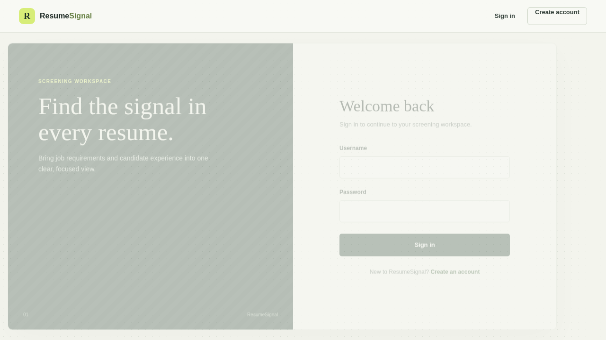
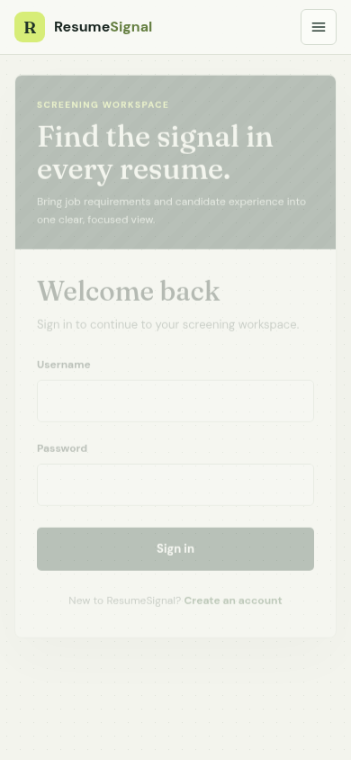

# ResumeMetrics

Resume screening workspace built with React and a Flask API.

## Screenshots

Desktop sign-in:



Mobile sign-in:



## Authentication and Deployment

- Passwords are sent only to the API over HTTPS in production and are hashed by Werkzeug before storage. Client-side password hashing is not a substitute for HTTPS.
- Set `APP_ENV=production` and provide a stable, private `JWT_SECRET_KEY` for the backend. The backend refuses to start in production without it. Generate one with `python -c "import secrets; print(secrets.token_urlsafe(48))"`.
- Set `CORS_ALLOWED_ORIGINS` to the exact HTTPS frontend origin when the API is hosted separately. The default allows only the local development origin.
- Set `REACT_APP_API_URL` to the HTTPS API origin when building the frontend for a separate API host. Same-origin development uses the React proxy.
- Production login and signup requests require HTTPS. When TLS terminates at a reverse proxy, ensure it sets `X-Forwarded-Proto` and that the Flask app is reachable only through that trusted proxy.
- Login failures are rate-limited to 10 attempts per IP per minute using the backend SQLite database. This limit is shared by processes using the same database file.
- Access tokens expire after 30 minutes and are stored in browser session storage. This limits persistence across browser sessions but does not protect against cross-site scripting; continue to prevent XSS and keep dependencies current.
- Do not commit service-account credentials. The local service-account JSON is excluded from Git and Docker build context. Because it was previously tracked, revoke and rotate that key in Google Cloud; ignoring the file does not remove copies from Git history.

Build the frontend with `npm run build`. Firebase Hosting serves the generated `build` directory. Run the Flask API behind an HTTPS-enabled production server and configure the environment values above before deployment.

## Run locally

You can run a fast, credential-free local mode for UI and API development, or run against real Google Cloud Storage. The credential-free mode uses local files and a lightweight word-overlap scorer; it does not validate Google Cloud access or use the production semantic model. Never enable `RESUMESIGNAL_LOCAL_TEST` outside local development.

### One-time setup

Use Node.js 20 or 22 and Python 3.10 for the backend's pinned ML packages. The lightweight local test dependencies also work with Python 3.12. From the repository root:

```sh
npm ci
python3 -m venv .venv
.venv/bin/python -m pip install --upgrade pip
.venv/bin/python -m pip install -r resume-screening-backend/requirements-test.txt
```

Run the end-to-end API smoke test (signup, login, upload, ranking, results, deletion):

```sh
.venv/bin/python -m pytest -q resume-screening-backend/test_local_e2e.py
```

### Start the app without Google Cloud

Terminal 1, from the repository root:

```sh
RESUMESIGNAL_LOCAL_TEST=1 \
DATABASE_PATH="$PWD/resume-screening-backend/users.local.db" \
RESUMESIGNAL_TEST_STORAGE="$PWD/resume-screening-backend/uploads.local" \
.venv/bin/python resume-screening-backend/app.py
```

Terminal 2, from the repository root (the `start` script enables polling to avoid the Linux watcher limit):

```sh
npm start
```

Open `http://localhost:3000`, create an account with a password of at least 12 characters, then upload a ZIP file containing PDF or DOCX resumes. The frontend's development proxy forwards `/api` requests to `http://localhost:5000`. Polling works around Linux's inotify watcher limit and can use more CPU while the dev server is running. If your system watcher limit has been raised, remove the polling environment settings from the `start` script in `package.json` for lower CPU usage.

If you prefer to fix the Linux watcher limit system-wide instead, inspect the current limit and raise it:

```sh
cat /proc/sys/fs/inotify/max_user_watches
sudo sysctl fs.inotify.max_user_watches=524288
```

To make that setting persist after reboot:

```sh
echo 'fs.inotify.max_user_watches=524288' | sudo tee /etc/sysctl.d/99-resumesignal-watches.conf
sudo sysctl --system
```

Then `npm start` can run without `CHOKIDAR_USEPOLLING=true`.

### Run against your Google Cloud Storage bucket

This mode uses the real Sentence Transformers model and Google Cloud Storage. It needs network access the first time it downloads the model, plus ADC credentials able to upload/download objects and sign the one-hour resume links. Keep credential files outside the repository. The app's bucket name is configurable with `GCS_BUCKET_NAME` (default: `resume-screening-resumes`). [Google's signed URL setup guide](https://docs.cloud.google.com/storage/docs/access-control/signing-urls-with-helpers) explains the required service-account signing permission.

1. Install the Google Cloud CLI, then set your project and select a globally unique bucket name:

```sh
gcloud auth login
export GCP_PROJECT_ID="your-gcp-project-id"
export GCS_BUCKET_NAME="a-globally-unique-bucket-name"
export LOCAL_SA_NAME="resumesignal-local"
export LOCAL_SA="${LOCAL_SA_NAME}@${GCP_PROJECT_ID}.iam.gserviceaccount.com"
gcloud config set project "$GCP_PROJECT_ID"
gcloud services enable storage.googleapis.com iamcredentials.googleapis.com --project "$GCP_PROJECT_ID"
gcloud iam service-accounts create "$LOCAL_SA_NAME" --project "$GCP_PROJECT_ID" --display-name "ResumeMetrics local development"
gcloud storage buckets create "gs://$GCS_BUCKET_NAME" --project "$GCP_PROJECT_ID" --location us-central1 --uniform-bucket-level-access
gcloud storage buckets add-iam-policy-binding "gs://$GCS_BUCKET_NAME" \
  --member="serviceAccount:$LOCAL_SA" --role=roles/storage.objectAdmin
```

2. Allow your Google user to impersonate that service account, then create ADC credentials for local application use:

```sh
export GOOGLE_USER="$(gcloud config get-value account)"
gcloud iam service-accounts add-iam-policy-binding "$LOCAL_SA" \
  --project "$GCP_PROJECT_ID" \
  --member="user:$GOOGLE_USER" --role=roles/iam.serviceAccountTokenCreator
gcloud auth application-default login --impersonate-service-account="$LOCAL_SA"
```

If you cannot use impersonation, you can instead set `GOOGLE_APPLICATION_CREDENTIALS` to the absolute path of a service-account JSON key. Do not put that key in this repository or send it in chat. Keyless impersonation is preferred.

3. Install the backend's production dependencies. This includes the Sentence Transformers model stack and CPU-only PyTorch; it is larger than the lightweight test dependencies:

```sh
.venv/bin/python -m pip install -r resume-screening-backend/requirements.txt
```

4. Copy the backend environment template and set its project, bucket, and local JWT secret:

```sh
cp resume-screening-backend/.env.example resume-screening-backend/.env
```

Set `JWT_SECRET_KEY` to a private random value (generate one with `../.venv/bin/python -c 'import secrets; print(secrets.token_urlsafe(48))'`). Set `GOOGLE_CLOUD_PROJECT` to `$GCP_PROJECT_ID` and `GCS_BUCKET_NAME` to `$GCS_BUCKET_NAME`. With ADC impersonation, leave `GOOGLE_APPLICATION_CREDENTIALS` commented out. If using a JSON key instead, set that variable to its absolute path in `resume-screening-backend/.env`.

5. Start the API from its directory so Flask loads `resume-screening-backend/.env`:

```sh
cd resume-screening-backend
../.venv/bin/python app.py
```

In another terminal, from the repository root, start the frontend:

```sh
npm start
```

This real-cloud mode uploads resumes into your bucket. It does not use `RESUMESIGNAL_LOCAL_TEST`. Avoid uploading real candidate data until you have configured your bucket access and data retention appropriately.

## Production deployment settings

The backend production requirements are intentionally limited to packages the API uses. They use CPU-only PyTorch for Sentence Transformers; the previous environment freeze included `tensorflow-intel`, which has no compatible Linux distribution and caused Cloud Run image builds to fail. Build the same backend image locally from the repository root with:

```sh
docker build -f resume-screening-backend/Dockerfile \
  -t resumemetrics-api:local \
  resume-screening-backend
```

This builds the image but does not start it or require Google Cloud credentials. The deployed container still needs the production environment variables and Google Cloud permissions described below.

The Cloud Run workflow uses GitHub Actions secrets `GCP_PROJECT_ID` and `GCP_SA_KEY` (JSON for a deployment service account). It expects a Secret Manager secret named `JWT_SECRET_KEY`, granted to the Cloud Run runtime service account. That runtime account needs `Storage Object Admin` on the configured resume bucket and `Service Account Token Creator` permission to sign resume URLs. Set the GitHub Actions variable `GCS_BUCKET_NAME` if the bucket is not named `resume-screening-resumes`; the workflow defaults to that bucket name. Never commit credentials, and revoke any service-account key that was previously committed.

If the deploy job reports that `GCP_SA_KEY` is not valid JSON, download a fresh JSON key for the deployment service account and replace the repository secret with the raw file contents. On Linux, you can validate and set it with GitHub CLI:

```sh
python3 -m json.tool /secure/path/gcp-deploy-key.json >/dev/null
gh secret set GCP_SA_KEY < /secure/path/gcp-deploy-key.json
```

The secret must be the plain UTF-8 JSON file, not Base64, not wrapped in quotes, and not UTF-16 encoded. The workflow checks the format without printing the credential. Do not paste the key into chat or commit it.
